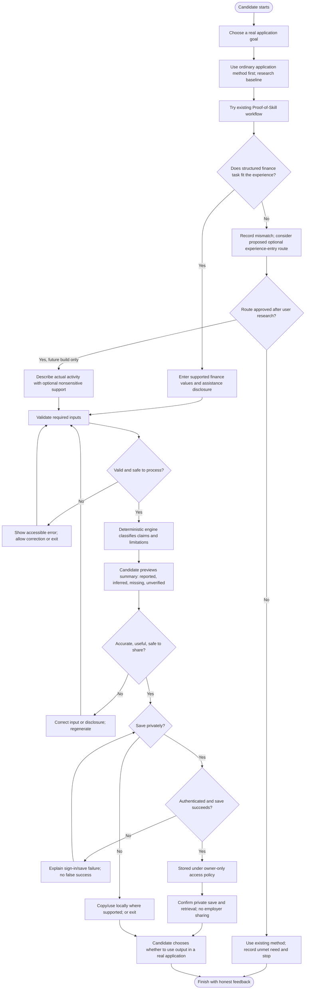
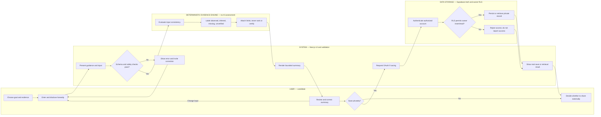
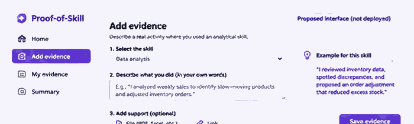

# WEEK 13 — BUSINESS BENDING
## REAL HUMANS — FIVE USERS WHO DON'T LOVE YOU
### PRE-CODE PACKET | Proof-of-Skill

**Hana Dager Abascal** | **Role: USER** | **Team 5** | **5 November 2026**  
**Product:** https://proofofskill.app  
**Source:** https://github.com/hanadagerab/proof-of-skill-week12  
**Status:** Research and implementation proposal; **not approved for coding**.

> **Evidence integrity statement.** No Week 13 real-user sessions, measured improvements, hiring outcomes, returning users, or deployments are claimed in this packet. The earlier 49.2-to-17.5-minute (~2.8×) comparison was **simulated**, not a real-world result. The final Week 13 Brain Bending Brief (5 November 2026, pp. 1–2) and Team 5 Week 13 Blueprint (pp. 1–3) were examined directly. The Team Blueprint labels itself “SIMULATED DRAFT — PENDING ACTUAL TEAM APPROVAL”; no final live team endorsement is claimed.

## Mandatory build-packet decision summary

**Exact user.** An adult Mexico-based early-career applicant or career changer who has performed practical analytical activities (inventory discrepancies, supplier comparisons, cost tracking, school or family-business decisions), but lacks a polished portfolio or conventional credential and needs one truthful, reusable description for a specific job application. The research sample is not assumed to represent all Mexican candidates.

**Measurable success definition.** Before the Week 13 module closes: (i) observe five distinct consenting real participants, including at least three strangers, completing or explicitly failing an uncoached baseline and product task; (ii) record paired time, steps, confusion, errors, accuracy and usefulness without suppressing non-completion; (iii) reconstruct at least one recent real hiring example with sourced versus recalled facts separated; (iv) document three ranked pains and an explicit build/no-build decision; (v) if justified, deploy one smallest safe correction with green automated checks and a documented before/after retest; (vi) preserve honest evidence of one person's genuine return intention or action, distinguishing them. **No prespecified percentage improvement is assumed.** Failure to meet a gate is reported, never manufactured.

**Global benchmark line.** *LinkedIn = skills linked to actual work and visibility; Forage = employer-designed practice simulations; Opportunity@Work = institutional recognition of skills gained through alternative routes; ordinary résumé support and well-prompted general-purpose AI = strongest low-cost substitutes.* Proof-of-Skill earns a specialized product only if observed users gain defensible clarity or reduced total burden over the best accessible substitute; these reference points are not outcome endorsements.

**Three-sentence long view.** Over time, Proof-of-Skill could become a candidate-controlled bridge between everyday analytical work and understandable evidence of ability. That future depends on demonstrated candidate benefit, credible employer recognition, and strict limits on what a summary can establish. If low-cost existing tools perform as well or better, the responsible long-term outcome is to recommend those tools rather than expand this product.

**Scope cut.** In scope for possible Week 13 iteration: one optional, low-friction existing-experience entry and candidate-controlled summary/copy improvement *only if observed friction warrants it*. Out: mandatory additional assessment, upload of employer-confidential material, skill verification, resume marketplace, applicant ranking, employer screening, job matching, new AI API, and redesigning authentication or persistence absent a discovered fault. The existing bounded finance exercise remains available; whether it becomes clearly optional is a **proposed** change, not current functionality.

**Architecture and stack table (source verified; runtime verification still needed).**

| Layer | Existing source / service | Week 13 decision |
|---|---|---|
| UI | Next.js App Router, React, TypeScript, Tailwind | Reuse components; focus candidate-readable copy |
| Validation | Zod / `lib/schema` | Validate new inputs only if approved |
| Evidence logic | Deterministic `lib/engine` | Preserve claim boundaries; do not present self-report as verified |
| Record shaping | `lib/submission.mjs` | Prevent stale draft / saved-result mismatch |
| Identity | Supabase Auth with Google OAuth | Preserve existing sign-in; avoid unnecessary sign-in for unsaved preview |
| Storage | Supabase Postgres, `submissions` with owner RLS | No new tables by default; check lawful retention/deletion |
| Hosting / source | Vercel / GitHub | Preview, regression checks, deliberate production approval |

**Security floor.** Obtain informed research consent; collect no raw identity documents or confidential workplace files; use anonymous participant IDs; avoid storing research notes with production records; enforce Supabase owner-only access and test across two accounts; never expose service-role secrets; use TLS and minimally necessary data; verify privacy notice, retention and deletion rights before collecting real candidate evidence; disclose that exporting/sharing leaves platform control; pause research on any suspected privacy incident. Existing database grants SELECT/INSERT but not DELETE, so deletion/retention is an **open gap**, not a promised feature.

**Implementation gates.** Research and packet approval → verify source/deployment parity and privacy readiness → five real sessions and recent hiring example → pain ranking and explicit approval of a narrow fix → implementation branch and automated tests → preview + accessibility/privacy checks → human retest → production deployment and rollback readiness → documented demo. Failure at a gate pauses the next stage; no code changes occur during pre-code packet preparation.

## A. Project identity and executive summary
Proof-of-Skill is an existing candidate-facing evidence-summary application developed from a bounded analyst work-sample concept. The Week 12 implementation uses Next.js, TypeScript, Supabase authentication and owner-restricted persistence, and Google OAuth. It separates submitted observations, conditional inferences, missing material, and unverified assertions. Week 13 changes the primary question from *can the application generate and save a bounded summary?* to *does this improve a candidate's actual application process compared with what they already do?* The assigned USER role makes candidate autonomy, accessibility, practical burden, and truthful representation the priority. We will recruit five real people (at least three strangers), observe their existing methods before showing the product, compare realistic outputs and effort, rank harms, and implement only the highest justified feasible correction after evidence is collected. No employer screening engine, marketplace, or hiring promise is proposed.

**Decision sought:** whether a candidate can reuse existing evidence to produce a clear, defensible application-ready description without doing an unnecessary new assessment. **Success before the module closes:** five consented sessions and comparison records; a documented top-three pain ranking; one evidence-justified correction deployed and retested, if warranted; and authentic evidence of one participant's voluntary return intention or action, without claiming actual return unless observed. If findings reject the value proposition, honest non-build or narrowing is an acceptable research result but must be reconciled with course delivery expectations.

## B. Problem and user vacuum
**One user need:** a Mexico-based early-career candidate with relevant analytical experience but no polished portfolio needs to communicate *what they actually did, what evidence supports it, and what remains unverified* in an application without duplicating substantial unpaid work. A résumé bullet may be too vague; a portfolio can be burdensome; another standardized exercise may add friction. The general context—that applications use CVs, work examples, and assisted writing—is plausible, not proof of a widespread unmet need. The unvalidated hypothesis is that this particular tool improves clarity or reduces burden relative to existing workarounds. The vacuum exists only if observed candidates cannot achieve equivalent results with ordinary résumé assistance or general AI at comparable cost and effort.

## C. Evidence from previous weeks
- **Week 4:** two synthetic candidates, four evaluator choices, and simulated review times of 49.2 and 17.5 minutes. This is design evidence, **not** observed candidate benefit or employer adoption.
- **Week 9:** project lessons emphasized authorship/AI-assistance disclosure and the distinction between a submitted claim and verified work; do not imply disclosure establishes authorship.
- **Week 12:** the repository contains a deterministic financial-task evidence classifier, structured form, Google sign-in action, save/read flow, and explanatory About page. Prior user-reported production checks found the live domain, OAuth return, and saved-summary retrieval functioning; these need independent current re-verification.
- **Prior persona work:** previous synthetic candidate/reviewer personas and copy corrections were design probes, not five independent real users. The repository's Week 12 packet identifies synthetic Daniela and Martín; its decisions log describes improved candidate-facing save text and arithmetic-conflict handling.
- **Brain Bending shift:** the Week 13 Brief explicitly moves from defending technical completion to defending the candidate’s right not to need this application; it warns against privacy exposure, unpaid duplicate work and turning unknown into unskilled. Its proposed two distinct fields (self-reported work history and demonstrated task reasoning), preview/correction and optional fictional task are safeguards to test, not deployed features. **Instructor's binding challenge:** obtain a recent real hiring example and a credible comparison beyond the simulated 2.8× number. Do not generalize the simulated result.
- **Known mismatch:** current homepage and product require a small financial exercise. Week 13's candidate-reuse goal may conflict with that flow; research first.

## D. Team Blueprint alignment
| Stated requirement | Product decision | Observable evidence / safeguard |
|---|---|---|
| USER role | Prioritize candidate experience, not employer throughput | Candidate task success, effort, comprehension, control |
| Five real users | Five separate, consented sessions | Participant IDs P01–P05, session records |
| Three strangers | Recruit at least three without personal relationships | Recruitment source and relationship field |
| Observe behavior | Baseline task before product demonstration | Screen notes, timestamps, errors, verbatim quotes |
| Compare alternatives | Same authentic application goal across methods | Baseline vs tool rubric and effort comparison |
| Avoid unsupported claims | Label observed/inferred/missing/unverified | Output audit and source checks |
| Demonstrate value without extra work | Permit reuse of prior experience; test incremental burden | End-to-end minutes and duplication count |
| Fix and retest | Rank pain before choosing change | Before/after record, commit, deployed verification |
| Preserve negative evidence | Record failures, refusals, no-preference results | Unedited session notes and decision log |
| Real hiring experience | Interview consenting recent applicant or reviewer | Dated, de-identified process reconstruction |
| Team vacuum separate | Do not implement Agua en seguimiento here | Individual venture scope explicitly stated |

**Provenance gate:** the exact Team 5 Blueprint has now been checked. Its collective primary vacuum is *Agua en seguimiento* (household repair ownership and verification), distinct from Hana’s individual Proof-of-Skill declaration. Collective Conditions 2–5 are tailored to other ventures; we use their general lessons without importing repair-verification mechanics into Proof-of-Skill. The team document is a simulated draft pending actual approval.

## E. Current product audit
**Verified in GitHub source (main branch read 5 Nov 2026):** `app/page.tsx` displays product positioning and correctly labels the simulated metric; `app/product/page.tsx` implements numeric revenue/cost/margin inputs, source notes, synthetic-data checkbox, assistance disclosure, evidence-summary generation, sign-in/out, save, load-history and human-decision explanations; `app/about/page.tsx` explains boundaries; `supabase/migrations/001_initial.sql` defines owner-specific select/insert RLS; `package.json` defines test, lint, typecheck and build scripts. The checked manifest specifies Next.js `^15.3.0`; do **not** assume the earlier recollection of 16.x matches this repository snapshot.

**Requires verification:** current production revision versus GitHub main, OAuth redirect on the actual domain, persistence after refresh, cross-account isolation, mobile and keyboard behavior, privacy/deletion pathways, whether users can easily export/copy a useful summary, and actual test/build status. Code presence does not prove production behavior.

**Proposed, not implemented:** a low-friction way to describe *existing* experience rather than completing a new finance exercise, if users demonstrate that need; a candidate-readable reusable output; clearer disclosure/uncertainty copy. Exact scope depends on the ranked pain.

**Excluded:** hiring recommendations, automatic ranking/rejection, job matching, employers' access to private records, identity/authorship certification, file ingestion without a demonstrated need, paid LLM/API integration, new database, and extra assessments by default.

## F. User journey and existing workarounds
Observe each participant preparing for a specific recent or realistic analytical job application: identify vacancy requirements; locate CV, class project, internship or informal work; choose evidence; write an accomplishment; decide whether to use Word, LinkedIn, a template, mentor, or AI; revise; decide what is truthful; and prepare a final shareable excerpt. Ask participants to use their normal tools first, not the new product. Record tool switching, time, re-entry, uncertainty, omissions, unsupported claims, and whether they can use the result. Then introduce Proof-of-Skill and observe whether it adds or removes work. For a participant with no suitable financial example, record the mismatch rather than manufacturing one.

## G. Hypothesis and value proposition
**H1:** Compared with each participant's existing method, a bounded evidence summary helps the participant produce a more specific, defensible description of analytical experience with acceptable incremental effort. **H0:** résumé editing, a mentor, or a general-purpose AI prompt is as good or better, or the product's finance exercise creates additional burden. Candidate benefit requires both adequate clarity/truthfulness and an acceptable workload; faster output alone is insufficient. The hypothesis is weakened if users cannot bring real experience into the flow, cannot explain the summary, need extensive manual rewriting, prefer their baseline, or would not use the result in an application.

## H. Global alternatives and competition
| Alternative | What it offers / distinction | Testable comparison and limit |
|---|---|---|
| LinkedIn | Professional profile, skills, experience and application-facing visibility | Can candidate articulate evidence in a normal experience entry just as clearly? Platform reach is not evidence of better individual outcomes. |
| Forage | Employer-designed virtual job simulations and completion artifacts | Different primary model: simulated experience rather than summarizing one's existing work. Compare extra task burden and relevance, not hiring outcomes. |
| Opportunity@Work / STARs | US-oriented skills-first labor-market advocacy and employer initiatives | **Institutional initiative, not a direct candidate evidence-summary app**; compare philosophy, not feature-for-feature workflow. Mexican applicability requires separate evidence. |
| Résumé help | Human counselor, template, peer, or career office can improve framing | Observe time, cost, edits, accuracy, and whether a portfolio is needed. |
| General-purpose AI | Prompted drafting, restructuring, and tailoring | Give a fair, useful prompt and compare the output; do not sabotage the baseline with a weak prompt. AI fluency and access differ. |

Do not assert superiority, pricing, coverage, adoption, or employment impact without a dated source and an observed test. In Mexico, examine Spanish-language wording, mobile access, university/internship artifacts, and confidentiality obligations; do not assume all applicants use LinkedIn or paid AI.

## I. Proposed Week 13 workflow
**Research-first candidate path:** (1) identify a real application goal; (2) select one existing experience or artifact; (3) state action, context, result, source, and assistance honestly; (4) review observed/inferred/missing/unverified distinctions; (5) copy or save a candidate-controlled description; (6) decide voluntarily whether to reuse it. **Minimal-change candidate:** reuse the existing classifier, boundary language and storage where appropriate, and add only a narrowly scoped experience-entry/copy path if the research shows the fixed finance task is the binding obstacle. This is **not approved implementation scope**. Do not force login for research tasks unless persistence genuinely requires it. Do not build an entire portfolio editor.

### Feature flowchart — candidate experience (proposed; not deployed)

The shaded/conditional path is a **research hypothesis**, not an existing production feature. The live Week 12 finance task remains the baseline until a correction is approved. The candidate can stop at any point without a hiring consequence.

### Actor swimlane — responsibility and trust boundaries

This proposed sequence separates USER action, SYSTEM validation/UI, the **deterministic evidence engine** (not an AI verifier), and DATA STORAGE. Human researchers observe the comparison outside the production application. No account or employer action is triggered merely by generating a summary.

### Image-generated proposed interface — research concept

**Proposed Week 13 interface — not yet implemented.** This concept shows a candidate describing an authentic analytical activity, receiving wording guidance, choosing optional support, and reviewing before any voluntary save. It does not imply the existing application has a general experience-entry route, document upload, or export controls; those are subject to five-user evidence, safety review, and explicit approval. The full-size image appears on a dedicated landscape page in the PDF for legibility.

## J. User safety and the Shadow
Do not request employers' confidential spreadsheets, personal identifiers, salary histories, customer data, or other third-party information. Use anonymized or synthetic substitutes if consent or ownership is unclear. State that self-reported AI assistance is disclosure, **not** authorship verification. Label quantitative results and claimed impact as unverified without source evidence; allow “I do not know.” Informal family-business, volunteer and school experience can count as experiences without being falsely presented as paid employment. Candidates must control whether to save or share; never automatically send to recruiters. OAuth proves account access, not the origin of submitted work. Researchers must not collect identifiable application documents in session notes. Do not promise employment, suitability, or verified skill.

## K. Five-user research protocol
**Recruitment:** five adults preparing or recently having prepared an internship, entry-level, or junior analytical application in Mexico; target variation in experience, digital comfort, and portfolio readiness. At least three must be strangers to the researcher (no existing personal relationship); record recruitment channel and relationship before sessions. Convenience sampling is acceptable but limits generalization. Avoid coercion, especially where researcher has academic or professional influence. Target 20–35 minutes per session; allow withdrawal without penalty.

**Consent script:** “I am testing an application workflow, not evaluating your abilities. Participation is voluntary; you may skip any question or stop. Please use an anonymized example and do not show confidential or personal documents. I would like to take anonymous notes and capture exact words. May I proceed? May I record the screen/audio separately?” Record consent independently for participation and recording. If recording is declined, continue with timestamped handwritten notes if consented; if participation is declined, log a refusal with no personal details and recruit a replacement. A refusal is **not** counted as a completed user test.

**Neutral tasks:** (T1) “Using your normal method, prepare a short explanation of one analytical ability for this job description”; (T2) “Show me what evidence supports that statement and what you would not claim”; (T3) “Now try this tool for the same purpose; tell me when you would stop”; (T4) “Which output, if either, would you actually use, and why?” Do not say the new tool is faster or better. Let participants work without coaching; rescue only for safety, consent or unrecoverable access problems and log the intervention.

**Observation record per participant:** ID; date; recruitment relationship; application context; consent/recording status; device/language; baseline start/end; product start/end; tool switches; errors and recovery; prompts/interventions; number of unsupported claims; output artifact (de-identified); exact quote in quotation marks with timestamp; observer interpretation in a separate field; final preference and reason; follow-up permission; negative findings. Never invent quotes or retrospectively rewrite raw notes.

## L. Comparison methodology
Use a **within-participant** comparison for the same application goal. Baseline is the participant's actual method; optionally use a fair general-AI prompt as a second comparator when they are willing and familiar with it. To reduce order bias, document that baseline-first is intentional because the purpose is to observe pre-exposure behavior; any learning transfer makes later speed comparisons exploratory, not causal. Time from start to usable output (minutes); active effort (number of entries, tool switches, copy/paste actions and self-reported burden 1–5); errors (unsupported claims, wrong figures, missing context); clarity (independent rubric 0–2 each for specific action, evidence, limits, and readability); truthful representation (participant confirms factual fidelity and observer flags unsupported claims); candidate preference and voluntary actual use. Include login and re-entry in total effort. Record **N/A** when tasks are not comparable. Do not average incomparable participants into a promotional “X× improvement.” Report individual pairs and uncertainty; five users cannot establish hiring impact or population-level efficacy.

## M. Recent hiring example
Recruit one consenting applicant who applied or interviewed within the previous 3–6 months, ideally for a junior analytical role, and/or a hiring reviewer who recently assessed such applicants. Document approximate month, role, job requirements, application steps, artifacts submitted, whether a work sample was requested, approximate time, feedback actually received, and whether the candidate's abilities were misunderstood. Verify where possible against a redacted vacancy, email, application record or interview instructions **without collecting identifiable copies**. Distinguish the participant's recollection from independently corroborated facts. Ask whether Proof-of-Skill would have replaced an existing step or merely added one. A single example cannot establish market demand, recruiter acceptance, or improved hiring odds.

## N. Pain-ranking framework
For each distinct pain assign 1–5 anchored scores: **human harm** (1 minor annoyance; 5 exclusion/privacy/material burden); **value-proposition threat** (1 peripheral; 5 product cannot solve stated need); **evidence strength** (1 speculative; 5 repeatedly observed and corroborated); **frequency** (1 one weak instance; 5 across most sessions); **fix feasibility** (1 impractical this week; 5 safely implementable). Prioritize using `0.30 harm + 0.30 threat + 0.20 strength + 0.15 frequency + 0.05 feasibility`. Safety-critical harms override numerical rank for escalation. Publish top three with observations, affected participant IDs, competing interpretations, and scores. Never choose the easiest fix merely because it is easiest; do not present scores as scientifically validated measurement.

## O. Before-and-after validation
Freeze a baseline screenshot, exact task, participant ID, session notes, and source commit before changing code. Choose a correction tied to the top-ranked pain, specify expected behavior and non-goals, obtain approval, create a branch, and implement. Re-run automated and manual tests, deploy a preview, then production after approval. Retest the same task with at least one original participant if available and one independent participant if feasible; separate familiarity effects from actual improvement. Capture before/after screen evidence, task times, error changes, direct quotes, and remaining problems. Do not claim improvement merely because the code changed or the UI looks cleaner.

## P. Return-user evidence
At the end ask neutrally: “Is there a specific future application or task for which you would choose to use this again? Why or why not?” Record a concrete intended occasion and permission to follow up. A spontaneous request for the link, a participant-initiated second visit, or a later voluntary use of the output is stronger evidence than “yes” to a leading question. Separate **stated intent**, **requested access**, and **observed return**. Do not manufacture visits, ask people to click repeatedly, or count a researcher-prompted retest as organic retention.

## Q. Technical architecture
**Observed repository structure:** Next.js App Router + React + TypeScript client form; `lib/schema` for input validation; `lib/engine` for deterministic evidence classification; `lib/submission.mjs` for record construction; `lib/supabase` for browser client; Supabase Auth/Google OAuth; Postgres `submissions` with owner-only RLS; Vercel hosting and GitHub version control. Existing migration grants authenticated users SELECT/INSERT on their own records, not update/delete or employer access. The system is not a generative AI verifier. A proposed existing-experience pathway should first reuse existing UI components and evidence boundary logic; do not add an LLM, vector database, file storage or employer API without a measured requirement. Review retention/deletion and actual user-facing data rights before accepting personal evidence.

## R. Testing and acceptance criteria
**Mechanical and synthetic persona validation (not real-user evidence):** rerun existing regression fixtures and add clearly labeled synthetic task cases for missing values, conflicts, safe refusal, false confidence, and candidate correction. **Automated:** `npm test`, `npm run typecheck`, `npm run lint`, `npm run build`; schema invalid/blank values, arithmetic mismatch, disclosed/unknown assistance, synthetic flags, snapshot-save consistency, no prohibited hiring verdict. **Privacy:** sign-out; no anonymous save; owner can read own records; second account cannot read first account; no secrets or confidential samples in logs; examine deletion rights and privacy notice. **Accessibility:** keyboard-only completion, focus indication, labeled inputs, readable errors and screen-reader status, contrast, zoom to 200%, Spanish comprehension where relevant. **Responsive:** narrow phone viewport and slower connection, no horizontal overflow, accessible save feedback. **Deployment:** preview URL, production URL, commit SHA, OAuth redirect, refresh/retrieval, browser console and Supabase error checks. **Human acceptance:** participant independently finishes or explicitly identifies a blocking mismatch, understands uncertainty, can accurately explain the output, and decides whether it is worth using. Passing tests alone does not validate product value.

## S. Risks, limitations and stopping rules
Five convenience-sampled users are not representative of Mexican applicants. Prior product experience and task order may bias comparison; subjective clarity ratings are not employer outcomes. Stop or narrow if the workflow requires unnecessary new assessment, produces unverifiable inflated claims, exposes confidential information, creates access barriers, or performs no better than a well-instructed AI tool. Pause collection if consent, privacy or account isolation fails. If all five prefer their current method, record the rejection and propose an honest pivot or de-scope rather than forcing a feature. If no genuine recent hiring example can be corroborated, report that limitation and do not substitute a fictional one.

## T. Build and deployment plan (only after explicit Packet approval)
**Gate 0:** reconcile final Brain Bending Brief and Team Blueprint; preserve the explicit “SIMULATED DRAFT — PENDING ACTUAL TEAM APPROVAL” status until genuine approval is documented; approve this individual packet separately. **Gate 1:** read repository main and current Vercel production deployment SHA; inspect Supabase schema and policy without changing data. **Gate 2:** recruit and complete five sessions, including three strangers, and one recent hiring case. **Gate 3:** publish baseline comparison, top-three pain ranking, chosen correction and acceptance criteria. **Gate 4:** create `week13/<short-fix>` branch; smallest code change; tests; commit with meaningful English message; preview deploy. **Gate 5:** retest, check mobile/privacy/accessibility and regressions; merge only if justified; verify live URL and SHA. **Gate 6:** preserve screenshots, session evidence, results, and demo. Roll back using the previous known-good Vercel deployment or Git revert if production behavior regresses; do not apply irreversible Supabase migrations without backups and review. **Course delivery minimum, conditional on actual implementation authorization:** plan at least **five meaningful, separately evidenced commits** (not artificial no-op commits) and **two distinct verified deployments** (such as an initial preview/baseline and a corrected preview or production release), each with URL, SHA and actual check result. If research justifies no code change, report that honest conflict with the delivery requirement rather than fabricating commits or releases. **Session Close:** after every working session append a dated entry to `docs/DECISIONS.md` with evidence examined, decisions, rejected alternatives, modifications, test results, commit/deployment IDs if any, remaining uncertainty and the precise next action. No terminal steps are required when integrations can safely read or perform the action, but tests may require a local runner.

## U. Expected evidence and final deliverables
1. `docs/PACKET.md` approved pre-code baseline and dated amendments, not backdated.
2. Five de-identified session records (`research/P01`–`P05`) with consent status, recruitment relationship, tasks, timings, exact quotes and failures; at least three strangers.
3. One de-identified recent hiring case with source/provenance notes.
4. Baseline-versus-product comparison table, artifacts and rubric, including negative findings.
5. Top-three pain ranking, chosen correction and rationale (or documented stop decision).
6. Before/after screenshots, tests, retest notes and unresolved issues.
7. At least five meaningful build commits and two verified deployments if a build is authorized; GitHub branch/commits, preview and production deployment URL, verified commit SHA, rollback reference; dated `docs/DECISIONS.md` Session Close entries.
8. Honest evidence of return intention, requested link or actual return, explicitly distinguished.
9. Live URL and demo script/video showing baseline problem, user evidence, change, live behavior and limits; screenshots of two deployments and at least one real retest when a fix is justified.
10. Final reflection on whether the candidate is genuinely better off, not only whether the app works.

## V. References and evidence provenance
**Primary course texts directly read:** Week 13 Brain Bending Brief, p. 1 §01–03 and p. 2 §04–06, including the precise user vacuum, Shadow safeguards and original debate shift; Team 5 Blueprint, p. 1 (simulated draft, three bets and Agua en seguimiento), p. 2 (Conditions 1–6 and Hana’s USER declaration), p. 3 (dissent and outstanding approval). These are course documents, not evidence that proposed user research already happened. **Student-provided project context (historical, not independently reverified here):** Week 4 synthetic comparison; Week 9 disclosure lessons; Week 12 live Google OAuth/save checks; instructor's real-hiring and credible-comparison feedback; student-described Week 13 Team 5 requirements. **Direct source inspection (5 Nov 2026):** GitHub `hanadagerab/proof-of-skill-week12`: `package.json`, `app/page.tsx`, `app/product/page.tsx`, `app/about/page.tsx`, `docs/PACKET.md`, `docs/DECISIONS.md`, `supabase/migrations/001_initial.sql`. **External reference starting points (official; not independent efficacy evidence):** LinkedIn https://www.linkedin.com/ ; Forage https://www.theforage.com/ ; Opportunity@Work https://opportunityatwork.org/ ; Supabase Auth https://supabase.com/docs/guides/auth ; Supabase RLS https://supabase.com/docs/guides/database/postgres/row-level-security ; Next.js https://nextjs.org/docs/app ; Vercel https://vercel.com/docs . **Untested hypotheses:** value of an experience-reuse pathway, candidate preference, comparative effort, return behavior, and employer recognition. **Verified primary documents:** *BRAIN BENDING | REAL HUMANS*, Hana Dager Abascal, 5 Nov 2026, pp. 1–2 (USER stance, alternatives, vacuum, Shadow, instructor feedback); *BLUEPRINT — Week 13 — Team Bending*, Team 5, pp. 1–3 (explicit simulated draft; conditions 1–6, individual declarations, dissent and unapproved team status).

---
**Outstanding approval:** The Team 5 Blueprint is a simulated draft pending actual team approval; its upload alone does not constitute approval. Preserve this status until a verifiable approval record exists. Individual USER declaration remains unchanged.

**PRE-CODE FREEZE:** No Week 13 application code changes, deployments, real-user claims, or test results were produced in preparing this packet. The user must explicitly approve this packet before any application changes.