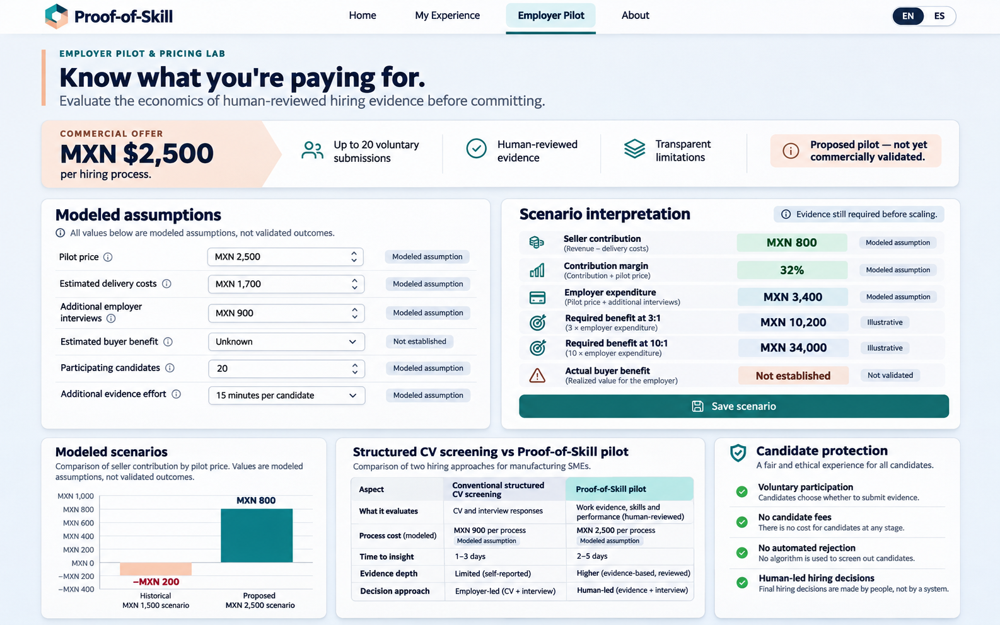
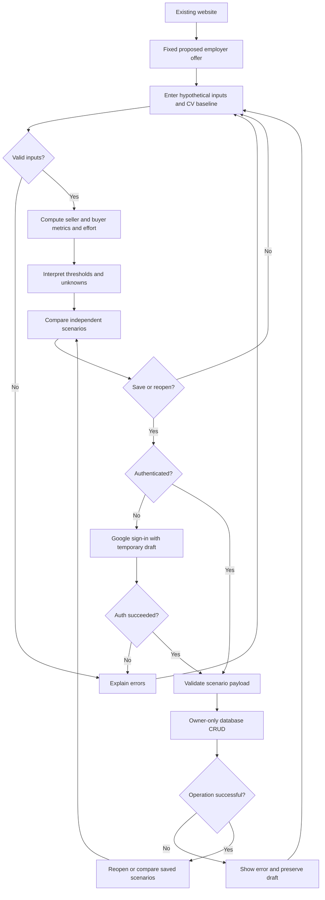
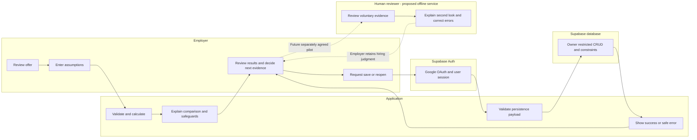

# WEEK 14 — BUSINESS BENDING
## Pricing — The Number That Tells the Truth
**Proof-of-Skill | Employer Pilot & Pricing Lab | Hana Dager Abascal | MONEY | 13 November 2026**

**Status: PRE-CODE PACKET — Gate A closed pending approval.** No application code, migration, payment or release is authorized. All financial figures are hypotheses. Sources: final MONEY Brief (12 Nov library version), BLUEPRINT_team2_FINAL.pdf (authoritative final Team Blueprint), master execution prompt and approved follow-up. The separate Crystal Ball Brief and original official assignment page have not been independently recovered.

## 1. Problem in my own words
I initially preferred MXN 1,500 because it was easier to ask for; avoiding rejection can hide weak demand and starve quality. Halving screening time frees capacity, not necessarily payroll; a hypothetical MXN 30,000 university contract needs demonstrable renewal value; three extra interviews can cost the employer MXN 900 while helping candidates. I will test MXN 2,500 for one bounded hiring process, not pretend a higher price creates buyer value. Target Mexican manufacturing SMEs with recurrent difficult-to-fill practical roles where screening may overlook relevant informal experience; exclude cases driven primarily by low wages, schedules, or genuine skill shortage. The free structured CV baseline must be a real comparator. Candidate time is not free simply because the employer pays.

## 2. Exact user
Laura Méndez, synthetic, 38, hiring/administrative operations manager in a Mexican manufacturing SME. Assumed workflow: CVs, Excel, WhatsApp and supervisor interviews; limited time/budget, skeptical of AI claims. These are design assumptions consistent with the Brief, not interviews. Secondary stakeholder: adult candidate with relevant formal or informal experience who may prefer ordinary or non-digital screening. No candidate names, resumes or records enter this simulator.

## 3. Success and acceptance criteria
Before the module closes, an employer can access /employer-pilot from the existing site, explain the fixed proposed MXN 2,500 offer and exclusions, model a valid scenario anonymously, distinguish contribution/margin from buyer ratio/ROI, compare two independent scenarios and a structured CV baseline, understand unknown outcomes and candidate effort, sign in with Google to save a named scenario, reopen/edit/duplicate/delete it in a later session, and identify evidence required to proceed. English and Mexican Spanish must support equivalent tasks; keyboard and mobile at 360px must work. All default calculations match section 11; no fabricated recommendations. Unauthorized CRUD must fail; candidate routes remain free and unchanged in behavior. These are acceptance gates, not completed tests.

## 4. Interface and generated mockup

*Figure 1. Independently generated pre-code concept, not implemented functionality or measured results.* GitHub confirms the asset at this path (blob f0e07dba0090445f039e7e38c4de0e784d26aedd). Design specification: navy #132A47 header, teal #197A84 accents, peach #EABDA1, pale #f4f7fb canvas; existing navigation plus Employer Pilot / Piloto para empresas. Fixed offer hero: MXN 2,500 per process, up to 20 voluntary submissions, human review of reported relevant experience, explanatory second-look report, limits and free corrections; no purchase button. Then economics, baseline comparison, saved scenarios, evidence gates. Progressive disclosure for cost categories; distinct seller/buyer outputs. Persistent candidate safeguards; show historical MXN 1,500 only in simulator, never as a purchasable offer. Unknowns displayed as unknown.

## 5. Mermaid feature flow

## 6. Mermaid swimlane

## 7. Global to local
The best existing solution on Earth for this is Greenhouse, as a benchmark for structured hiring workflows, not a claim of universal superiority.
Mine differs or localizes by offering a narrow human-reviewed pilot for existing practical experience in Mexican manufacturing SMEs rather than selling a complete ATS.
- Greenhouse integrates hiring stages and scorecard-based feedback; adapt to Excel and supervisor interviews without another ATS. https://www.greenhouse.com/ats
- TestGorilla offers free basic assessments and qualifying questions plus paid capacity; role-specific informal experience may need a different approach. https://www.testgorilla.com/pricing/
- Handshake provides free basic job posting and paid coordination/outreach; early-talent networks do not establish demand in this segment. https://joinhandshake.com/employers/pricing/
Official pages fetched 13 Nov 2026. None validates local price or ROI. Cheapest credible substitute: three job-relevant structured questions in current CV/spreadsheet workflow, same criteria and supervisor review.

## 8. Three-year charter
If the pilot demonstrates paid repeat demand and defensible candidate benefit, Proof-of-Skill could become a candidate-controlled bridge between practical experience and human-reviewed hiring consideration. Repeatable Mexican employer workflows would disclose costs, evidence provenance and corrections while measuring actual incremental value over free alternatives. Expansion would remain conditional on sustainable delivery and candidate protection rather than automated judgment or geographic growth for its own sake.

## 9. Scope cut
No payments or fake checkout, automated hiring decisions, ranking, rejection, claim certification, guarantee, full ATS, candidate personal data collection, payroll integration, paid AI or infrastructure, or candidate redesign. Operational reviewer service and actual paid evidence are external to software; validation panel is informational only.

## 10. Architecture and security boundaries
Read-only findings: repository hanadagerab/proof-of-skill-week12; recorded READY production main SHA 0837fb29cce33cb0028c25cb8839b00d8a15d605, Vercel deployment dpl_E6LtpYZu5tympu3dQwMvd1jm5kK7; hana-builds project verified association with proofofskill.app. Direct public fetch failed; browser runtime not verified. Source package declares Next ^15.3, React ^19, TypeScript ^5.8, Tailwind ^4, Zod ^3.24; resolved lockfile version not checked. app/layout.tsx, app/page.tsx, app/globals.css, app/experience/page.tsx (partial), lib/supabase.ts, package.json and prior docs inspected; full tree unavailable through file-only endpoint; auth callback guessed path returned 404, follow actual existing sign-in flow before code. Supabase public.submissions RLS enabled with authenticated owner INSERT/SELECT confirmed via catalog metadata only; no private rows retrieved. Existing client reads public URL and anon key from environment. Existing experience is local copy/download, bilingual route with optional Google sign-in. Existing finance records separate.
| Layer | Proposed role |
|---|---|
| Next/React/TS | Isolated /employer-pilot route and minimal nav change |
| Tailwind/CSS | Reuse brand and responsive controls |
| Zod + pure TS | Shared strict validation and deterministic calculations |
| Supabase Auth | Existing Google OAuth, no login to calculate |
| PostgreSQL | Separate owner-only pricing_scenarios table |
| GitHub/Vercel | Branch, preview, approved production only |
| Node tests / ESLint / tsc / build | Existing npm scripts; full checks after code |

Proposed schema: pricing_scenarios(id UUID PK default gen_random_uuid(), user_id UUID NOT NULL references auth.users(id) on delete cascade, name text NOT NULL length 1–80 trimmed, model_version integer NOT NULL fixed 1, inputs JSONB NOT NULL, created_at and updated_at timestamptz NOT NULL). Index user_id,updated_at; strictly typed JSON fields validated by server and DB checks or typed columns; no result cache required. Reject unknown fields, malformed values and ownership override. Database constraints enforce numeric bounds, count integers, optional nulls, version and payload size <=16KB. Owner set from authenticated identity; RLS SELECT/DELETE USING auth.uid()=user_id, INSERT WITH CHECK same, UPDATE both. Grant CRUD only authenticated; no anon grants; no service-role browser key. Update timestamp server-side. Save new vs update explicit; duplicate creates new UUID; delete confirmation. Preserve non-sensitive draft for up to ten minutes in tab session storage with consent, clear on restore/logout; storage failure explicit. Verify safe OAuth redirect allowlist and existing callback before coding.

## 11. Financial specification
All assumptions in MXN per process; cents precision, integer cent arithmetic for currency; round ratios only for display (2 decimals), avoid division by zero. All money 0–10,000,000, up to 2 decimals; minutes 0–1,440 per person; integer counts 0–20 for matched cohort and participating candidates, participation <= cohort. Unknown optional outcomes represented null, not zero; inputs reject NaN, Infinity, negatives, scientific notation if not supported, excess precision, blank required values. Fixed offer constant 2500 independent of scenario state.
| Default seller category (illustrative allocation) | MXN |
|---|---:|
| Acquisition | 300 |
| Onboarding | 150 |
| Review labor | 650 |
| Delivery | 250 |
| Support | 150 |
| Corrections | 100 |
| Exceptions/other | 100 |
| Total | 1700 |
No double counting; review labor cost can be derived from hours x rate OR direct cost, never both. Excluded shared overhead and taxes separately disclosed. S=sum categories; contribution=P-S; margin=100(P-S)/P if P>0 else N/A. Employer additional interviews I=count x per interview cost (default 3 x 300=900) or direct amount, not both. Other incremental costs O=0 default. E=P+I+O; required benefit 3E and 10E. Benefit B optional attributable incremental monetary benefit; ratio B/E and net ROI 100(B-E)/E only when B known and E>0. Default 2500-1700=800, 32%; E=3400, thresholds 10200/34000, B unknown. Historical 1500 yields -200 and -13.33%, not a current offer. Higher cost preset 2800 yields -300, -12%. Zero price or buyer cost ratios N/A, not infinite.

Baseline comparison: same cohort N (default 20). Structured CV screening minutes per candidate t0=10 and pilot employer screening minutes t1=7 illustrative; total H0=N*t0/60, H1=N*t1/60; capacity freed H0-H1 (negative allowed). Optional employer labor rate r (default unknown) yields capacity equivalent (H0-H1)*r, never automatically cash savings or added B. Baseline and pilot consideration counts c0,c1 optional integers 0..N; delta c1-c0 if both supplied, otherwise unknown; no automatic monetary value. Extra interviews tracked separately from reconsideration; candidate effort baseline N*b0/60, pilot participating n*b1/60 plus ordinary screening effort for nonparticipants (N-n)*b0/60; b0/b1 total per format, unknown allowed. Separately report incremental evidence burden n*extra_minutes/60 (default 20*15/60=5h); do not double count into total if b1 already includes it. User may enter actual attributable additional cost in O, not capacity equivalent. B must be incremental vs structured baseline and supported by evidence, not guessed. Side-by-side scenarios store independent raw inputs; reset to defaults; compare saved versions; show deltas only for known values. Unknown counts/outcomes show missing evidence.
Decision rules: seller contribution >0 positive, =0 break-even, <0 deficit. B null means unknown; E=0 ratio undefined; ratio <1 under cost, 1–<3 covers cost but below target, 3–<10 promising modeled hypothesis, >=10 meets modeled threshold only. At 10200/3400 ratio 3x, net ROI 200%. Sensitivity: vary P, S, I, O and B one at a time +/-10% within bounds; rank absolute impact on contribution or benefit gap 3E-B, not causal rankings. If B unknown, show threshold sensitivity only. Candidate safeguards take priority; failure triggers pause regardless of margins. No scenario is commercially validated by math.

## 12. Blueprint traceability
Authoritative source: BLUEPRINT_team2_FINAL.pdf. Collision 2 was confirmed 4/4: test, not validate, MXN 2,500; compare against structured CV screening and measure contribution, employer benefit, additional interviews and candidate effort separately. Hana's declaration (conditions 2–5) commits to a capped hiring-process pilot, paid commitments, costs, interviews and candidate effort; MXN 1,700 cost and MXN 800 contribution are assumptions, not measured ROI. Three genuine paid commitments are a test threshold, not proof. Candidate evidence remains voluntary, correctable and nonexclusive; absence of a flag cannot cause automatic rejection. Independently examine additional hiring consideration. The 90-day and spending caps are individual precommitments, not numerical requirements in the team Blueprint.
| Condition | Product / acceptance | Test | Required real evidence / limitation |
|---|---|---|---|
| Transparent exchange | Fixed price, term, inclusion, limits, substitute; scenario independent | T18,T23 | Actual buyer understanding |
| Observed demand | Baseline comparator and evidence checklist | T24,T27 | >=3 genuine paid qualified commitments, refusals, time-on-task and repeat behavior; no simulated payment |
| Fully costed delivery | Itemized full acquisition/onboarding/review/delivery/support/correction/exception costs | T01,T02,T25 | Actual labor and positive fully measured contribution, feasible delivery |
| Outcome verification | Unknown outcomes remain unknown; ratio distinct from ROI | T03–T06,T24 | Pre-record shortlist; independent review of incremental reconsideration, no guaranteed hiring |
| Shadow Clause | Voluntary, no candidate fee, non-digital route, free correction, same criteria, provenance, human decisions, notification on material error | T10,T17,T26 | Actual compliance and candidate benefit; checkbox is not proof |
| Precommitted stopping | Explicit pause/narrow rules | T27 | Within 90 days, validation spend <=10000 and total personal exposure <=30000; meaningful repeat demand and defensible candidate benefit; stop on failed safeguard or economics; no unmeasured discount |

## 13. Five security checks
1. No secrets: inspect diffs/history and gitignore, never log env values, no service role in client.
2. Auth: current Google OAuth preserved; anonymous calculator, signed-in save/read only; verify session and safe return.
3. RLS: new table enabled, private owner CRUD, test anonymous and two-account access including forged owner and updates.
4. Validation: strict shared schema plus DB constraints, size/range limits, malformed payload rejection, safe denominator handling.
5. Synthetic demo: invented named scenarios only; no real applicant records, contact information or private financial exercise data. Existing submissions untouched. Run advisors and review existing prior-doc warning re public security-definer function before release; current status unverified.

## 14. Mechanical test plan
Every case NOT RUN. Pass only if actual output matches and evidence recorded (input, expected, observed, status, commit/deploy).
| ID | Input/action | Expected/pass criterion |
|---|---|---|
| T01 | 2500,1700 | 800; 32% |
| T02 | 1500,1700 | -200; -13.33% |
| T03 | 2500+900+0 | 3400 |
| T04 | E=3400 | 10200 at 3:1 |
| T05 | E=3400 | 34000 at 10:1 |
| T06 | B=10200,E=3400 | 3x and 200% |
| T07 | P=0,E=0 | N/A ratios, no Infinity |
| T08 | negative, NaN, oversized, fractional count, malformed JSON | rejected client/server/DB |
| T09 | edit scenario A with B unchanged | independent accurate deltas/reset |
| T10 | n=20, extra=15 | 5h |
| T11 | anonymous visit | calculate without auth |
| T12 | anonymous save | sign-in prompt; DB denied |
| T13 | Google save then new session | exact inputs restored |
| T14 | edit, duplicate, delete owned scenario | correct CRUD and confirmation |
| T15 | accounts A/B, forged owner | no cross-user SELECT/INSERT/UPDATE/DELETE |
| T16 | direct malformed or unauthorized DB write | denied |
| T17 | inspect candidate safeguards | all visible; no ranking/rejection |
| T18 | inspect offer copy and results | proposed only, no fake payment/ROI |
| T19 | toggle EN/ES | equivalent fields and MXN formatting |
| T20 | 360px and keyboard-only | core tasks, no clipping, visible focus |
| T21 | /experience, /product, /about, saved finance | original flows unchanged |
| T22 | compare SHA/deploy/domain | intended version only |
| T23 | edit scenario price to 1500 | fixed offer still 2500 |
| T24 | N=20,t0=10,t1=7, unknown consideration | capacity freed 1h, no cash benefit, outcome unknown |
| T25 | direct vs derived review/interview costs | no double counting; cost categories total |
| T26 | failed safeguard with 10x ratio | pause, never greenlight |
| T27 | 0 paid commitments, expired 90 days or cap breached | no validation claim; pause |
| T28 | OAuth canceled/storage blocked | clear error; no phantom save |
| T29 | B blank vs zero | unknown vs 0x and -100% when E>0 |
| T30 | compare two saved versions across sessions | same results; no data leak |

## 15. Execution, persona and evidence plan
Gate A requires actual generated mockup, complete packet committed before application code and explicit approval. Then docs/IMPLEMENTATION_PROMPT.md; meaningful commits for offer/calculator, comparison, persistence, tests, genuine fixes and final evidence (at least five total). Run npm test, typecheck, lint, build. Preview with production untouched; record IDs/SHA/URL/status. Find genuine defect via boundary/accessibility/security tests; reproduce, fix, regress and deploy second preview (no manufactured bug). Fresh chat synthetic Laura persona attempts find offer, scope/exclusions, compare 1500/2500, explain seller economics and employer thresholds, modify assumptions, save/reopen, identify safeguards, decide next step. Capture actual quotes/screenshots where possible; synthetic is not payment evidence. Gate B requires user to run fresh chat; fix highest consequential observed issue and retest. Before Gate C verify security, regression, migrations, rollback to prior READY deployment, request production authorization. No database migration before approval; use backward-compatible additive schema after approval. Production domain unchanged until Gate C. Final PDF packet/persona/build transcript, demo script, rubric audit with actual evidence only. Session Close: append DECISIONS.md, commit/push each meaningful session, disclose limitations and actual hashes. Next move: verify PDF and diagram rendering, then request Gate A. No application code written in this packet.

## 16. Evidence checklist
Completed: authoritative MONEY Brief and Blueprint read; official benchmark pages fetched; repo/project/domain/deployment and RLS metadata inspected; dedicated branch created; financial specification, baseline comparison, six-condition matrix, Mermaid source, security and test plans drafted. Outstanding: PDF visual inspection, Mermaid render verification, complete source-tree/auth/runtime inspection, separate Crystal Ball document, explicit Gate A approval. No executed Week 14 product tests, paid commitments, migrations, deployment or candidate outcomes claimed.
